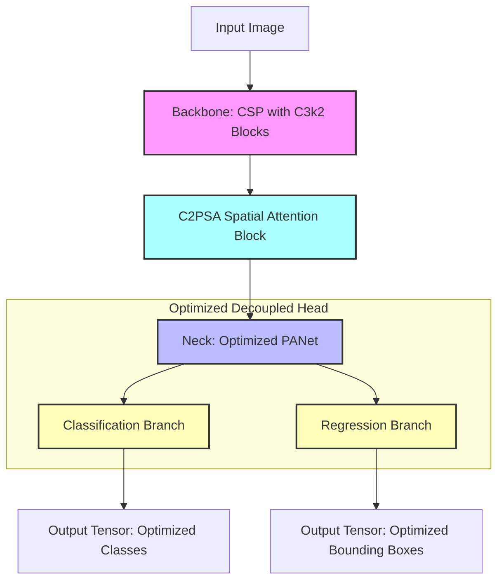

# 🎯 YOLOv11: State-of-the-Art Attention & Edge Efficiency

Released in late 2024 / early 2025 by Ultralytics, **YOLOv11** represents the cutting-edge standard for real-time computer vision. Its primary design goal was not just to boost raw accuracy, but to optimize the **mAP-per-parameter ratio**—providing state-of-the-art capability with extremely low model footprint and processing overhead.

YOLOv11 maintains the clean, modern **`ultralytics` API** framework introduced in YOLOv8, but introduces revolutionary modular components inside the network layers.

---

## 🏛️ YOLOv11 Architectural Anatomy



### 1. The Backbone: C3k2 Blocks
* YOLOv11 replaces YOLOv8's C2f blocks with **C3k2 blocks** (CSP Bottleneck with 3 convolutions and 2 kernel configurations).
* **Why C3k2?** C3k2 is highly modular and customizable. It allows the model to dynamically choose kernel sizes depending on the size of the target objects it's parsing, greatly improving performance on small objects without increasing resource consumption.

### 2. Spatial Attention: C2PSA (C2 Spatial Attention)
* YOLOv11 introduces **C2PSA**, which integrates spatial self-attention directly into the CNN backbone pipeline.
* **Why attention?** Traditional CNNs process every region of an image equally. Attention layers allow the model to "weigh" different regions of the image, calculating correlations between features so the network focuses heavily on objects of interest (e.g., a pedestrian in a crowded crosswalk) and completely ignores background clutter (e.g., asphalt, brick walls).
* Spatial Attention is highly optimized in YOLOv11 to ensure it remains lightweight enough to run in real-time on edge devices (like Raspberry Pi, mobile phones, or embedded GPUs).

### 3. Ultimate Edge Efficiency
* Compared to YOLOv8, YOLOv11 achieves higher accuracy (mAP) while using **significantly fewer parameters and FLOPS**.
* This makes it the premier choice for low-power edge applications, real-time robotics, and resource-constrained environments.

---

## 💻 Python Implementation: The State-of-the-Art API

YOLOv11 leverages the same robust, developer-centric Ultralytics syntax as YOLOv8, making it an instant drop-in replacement.

### Core API Structure
```python
from ultralytics import YOLO

# Load a pre-trained YOLOv11 small model
model = YOLO("yolo11s.pt")  # Notice the naming convention: 'yolo11s.pt'

# Run Inference
results = model("test_scene.jpg")

# Parse & display results
for r in results:
    # Rich, fast, and unified results representation
    print(r.speed)  # Outputs pre/inference/post-process latencies in ms
    r.save()
```
