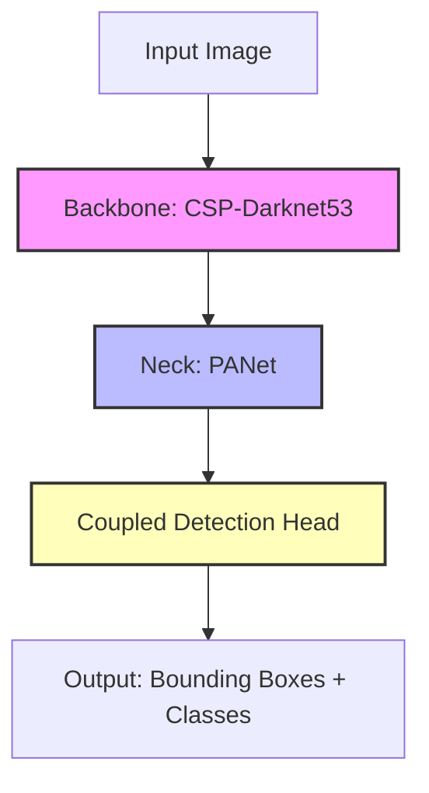

# 🏷️ YOLOv5: The PyTorch Pioneer

Released in 2020 by Ultralytics, **YOLOv5** was a watershed moment for real-time computer vision. Rather than relying on the traditional, hard-to-compile C-based Darknet framework of its predecessors (YOLOv1-v4), YOLOv5 was written from the ground up in **native PyTorch**. This made it incredibly easy to integrate, train, and deploy.

---

## 🏛️ YOLOv5 Architectural Anatomy



### 1. The Backbone: CSP-Darknet53
* YOLOv5 utilizes **Cross-Stage Partial networks (CSP)** in its backbone. 
* By splitting the feature map of a stage into two parts and merging them through a cross-stage hierarchy, it reduces computations while maintaining gradient propagation flow. 
* Feature extraction relies on **C3 blocks** (three convolutional layers with bottleneck structures).

### 2. The Neck: PANet (Path Aggregation Network)
* The neck is responsible for combining features extracted at different levels of the backbone.
* YOLOv5 utilizes **PANet**, which uses a bottom-up path to augment low-level spatial features to higher semantic levels, making it excellent at detecting objects of varying scales.

### 3. The Head: Coupled Detection Head (Anchor-Based)
* YOLOv5 is **anchor-based**. It requires pre-defined bounding box coordinates called "anchor boxes."
* The final output tensor is **coupled**: class confidence and bounding box coordinates are predicted together within the same feature maps.
* **The Anchor Bottleneck:**
  * To get high accuracy, the anchors must closely match the bounding box distributions in the dataset.
  * During initialization, YOLOv5 executes an **AutoAnchor** process, running K-means clustering on target labels to auto-calculate the best anchors for your data.
  * *Downside:* If your testing images contain objects with highly unconventional aspect ratios that were not in the training set clusters, the anchor-based head will struggle to regress them.

---

## 💻 Python Implementation: PyTorch Hub

In our `detector.py`, we load YOLOv5 using PyTorch Hub. This reflects the standard deployment model before the comprehensive `ultralytics` library was formalized.

### Core API Structure
```python
import torch

# Load standard YOLOv5 small model from PyTorch Hub
model = torch.hub.load('ultralytics/yolov5', 'yolov5s', pretrained=True)

# Run Inference
results = model(image)

# Parse Results
results.print()  # Display predictions in console
results.save()   # Save annotated image to disk
```

### Execution Flow under the Hood
1. **Pre-processing:** Image resize, normalization, converting color space from BGR (OpenCV) to RGB.
2. **Inference:** Forward pass through the CSP-Darknet backbone and PANet neck, generating coupled predictions.
3. **Post-processing:** Running **Non-Maximum Suppression (NMS)** to filter out overlapping duplicate boxes using intersection-over-union (IoU) thresholds.
