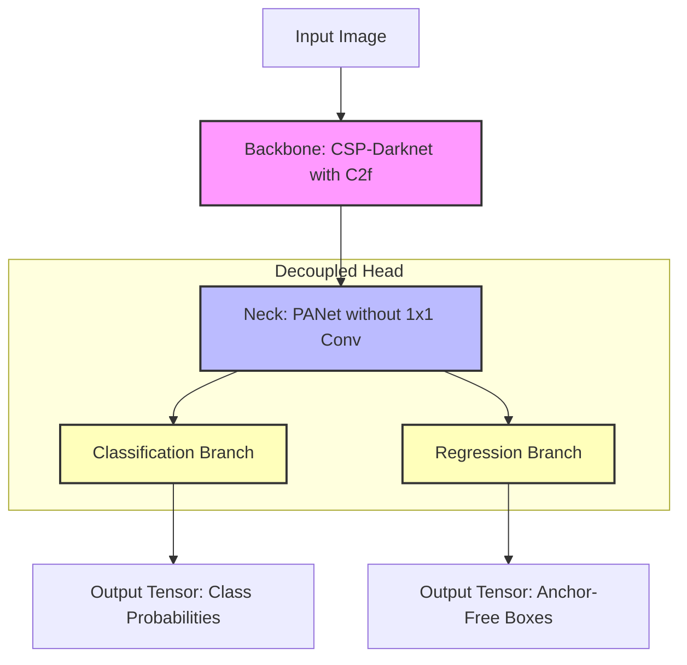

# 🎛️ YOLOv8: The Decoupled & Anchor-Free Leap

Released in January 2023 by Ultralytics, **YOLOv8** represents a massive paradigm shift in the YOLO architecture design. It broke away from several long-standing design philosophies established since the original YOLO paper to deliver a highly accurate, faster, and much cleaner model framework.

In addition, YOLOv8 introduced the unified **`ultralytics` Python package**, completely streamlining how models are loaded, trained, and integrated.

---

## 🏛️ YOLOv8 Architectural Anatomy



### 1. The Backbone: C2f (CSPLayer with 2 Convolutions and Faster branching)
* YOLOv8 replaces YOLOv5's C3 blocks with **C2f blocks**.
* **What makes C2f better?** While C3 splits feature maps and routes them, C2f routes all intermediate outputs from the bottleneck branches directly to the concatenation step. This preserves complex multi-scale spatial representations and improves the model's gradient flow back-propagation.

### 2. The Head: Decoupled Detection Head
* Classification (recognizing the category) and Regression (pinpointing borders) are mathematically contradictory tasks:
  * **Classification** requires *translation invariance* (the object is a dog, no matter where it is in the picture).
  * **Regression** requires *translation covariance* (moving the dog changes the box boundaries).
* YOLOv5 forced a coupled head to do both together, creating a bottleneck.
* YOLOv8 solves this with a **Decoupled Head**: it splits the tasks into independent branches, resulting in faster convergence and higher accuracy.

### 3. The Paradigm: Anchor-Free Detection
* YOLOv8 eliminates anchor boxes entirely! 
* Instead of scaling predefined templates, it directly predicts the offset distances from a pixel coordinate center to the top, bottom, left, and right borders of the target object.
* This removes the need for K-means clustering calculations on dataset anchors, generalizes immediately to arbitrary proportions, and makes the model highly robust.

---

## 💻 Python Implementation: The Modern Ultralytics API

The transition from YOLOv5 to YOLOv8 also clean-swept the API. The syntax is highly abstracted, clean, and developer-friendly.

### Core API Structure
```python
from ultralytics import YOLO

# Load a pre-trained YOLOv8 small model
model = YOLO("yolov8s.pt")

# Run Inference with integrated preprocessing & latency logging
results = model("test_scene.jpg")

# Parse & display results
for r in results:
    print(r.boxes.xyxy)  # Extract bounding box coordinates directly
    r.save()             # Save annotated frames
```

Under the hood, NMS and bounding box formats are calculated automatically by the C++ engine backend of PyTorch/Ultralytics, returning rich object oriented attributes (`r.boxes.xyxy`, `r.boxes.conf`, `r.boxes.cls`).
